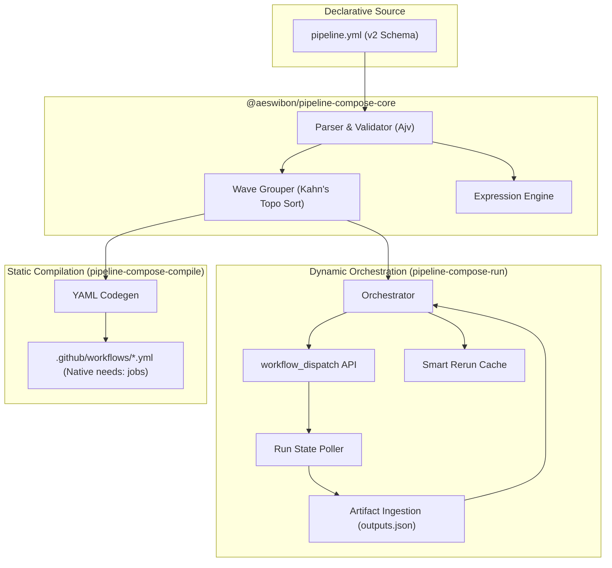

# pipeline-compose

<p align="left">
  <a href="https://github.com/abhiudayg/pipeline-compose/releases"></a>
  <a href="LICENSE"></a>
  <a href="https://github.com/abhiudayg/pipeline-compose/actions"></a>
  <a href="https://github.com/abhiudayg/pipeline-compose"></a>
</p>

**Cross-repo CI/CD orchestration that runs natively inside GitHub Actions.**

Native `needs:` dependencies only work within a single workflow file in a single repository. When a release spans multiple repositories—such as a microservice repo, a dedicated QA/E2E test suite repo, and an infrastructure or deployment repo—teams typically resort to fire-and-forget `repository_dispatch`, fragile polling bash scripts, or complex external CI servers (Jenkins, Spinnaker).

**Pipeline Compose** gives you one declarative `pipeline.yml`: ordered stages, wave parallelization, wait-for-completion, and dynamic `${{ context.<stage>.<key> }}` data wiring across repositories—without external servers, custom polling bash, or leaving GitHub Actions.

---

## The Problem & The Solution

| What you have today | What breaks | How Pipeline Compose solves it |
| :--- | :--- | :--- |
| **`repository_dispatch`** | Fire-and-forget; no waiting; no error status back | **Synchronous Orchestration**: Waits for stage completion; fails pipeline if child fails |
| **`workflow_call`** | Strictly intra-repository only | **Cross-Repo Native**: `repo: org/repo` dispatches across repositories with GitHub App or PAT auth |
| **Bash + `gh run view` polling** | High maintenance, unstandardized, fragile | **Standardized Node Engine**: In-memory artifact extraction, automatic retries, and commit status updates |
| **Separate CI Server (Jenkins/Argo)** | High operational and infrastructure cost | **Zero External Infra**: Runs entirely on your standard GitHub Actions runners |

---

## Architectural Overview: Two Execution Paths

Pipeline Compose provides **one semantic model** with **two complementary deployment modes**:



1. **Run Path ([`pipeline-compose-run`](https://github.com/abhiudayg/pipeline-compose-run))**:
   - Best for: Multi-repo releases (`repo: org/repo`), dynamic nested sub-pipelines, and attempt-scoped smart rerun.
   - Behavior: An orchestrator workflow job dispatches stages, polls for completion, downloads output artifacts, and feeds context forward.
2. **Compile Path ([`pipeline-compose-compile`](https://github.com/abhiudayg/pipeline-compose-compile))**:
   - Best for: Single-repo pipelines requiring committed audit trails and native GitHub UI dependency graphs with zero runner idle overhead.
   - Behavior: Compiles `pipeline.yml` into a static GitHub Actions workflow file with native `needs:` jobs.

---

## The Actions Ecosystem

| Action | Repository | Role |
| :--- | :--- | :--- |
| **Run** | [**`pipeline-compose-run`**](https://github.com/abhiudayg/pipeline-compose-run) | Primary orchestrator: dispatches stages, polls, and merges context |
| **Export** | [**`pipeline-compose-export`**](https://github.com/abhiudayg/pipeline-compose-export) | Uploads stage `outputs.json` artifact for downstream consumption |
| **Compile** | [**`pipeline-compose-compile`**](https://github.com/abhiudayg/pipeline-compose-compile) | Compiles pipeline YAML into a static committed workflow with native `needs:` |
| **Eval** | [**`pipeline-compose-eval`**](https://github.com/abhiudayg/pipeline-compose-eval) | Evaluates conditional `when:` expressions in custom workflows |
| **Context Merge** | [**`pipeline-compose-context-merge`**](https://github.com/abhiudayg/pipeline-compose-context-merge) | Merges stage outputs into a local JSON file without the full runner |

---

## Quick Start

### 1. Define Your Pipeline (`.github/pipelines/pipeline.yml`)

```yaml
version: 2
pipelines:
  release:
    stages:
      - id: ci
        workflow: .github/workflows/ci.yml

      - id: e2e
        workflow: .github/workflows/e2e.yml
        repo: my-org/qa-repo
        needs: [ci]
        inputs:
          image_tag: ${{ context.ci.image_tag }}

      - id: deploy
        workflow: .github/workflows/deploy.yml
        needs: [e2e]
```

### 2. Export Outputs in Stage Workflows

In any stage workflow that produces data for downstream stages (e.g. `ci.yml`):

```yaml
- name: Export Stage Outputs
  uses: abhiudayg/pipeline-compose-export@v1.17.2
  if: success()
  with:
    stage_id: ci
    outputs: '{"image_tag":"${{ steps.build.outputs.tag }}"}'
```

### 3. Trigger the Orchestrator

In your entry workflow (e.g. triggered on tag push or manual dispatch):

```yaml
name: Release Orchestrator
on:
  push:
    tags:
      - 'v*'

jobs:
  orchestrate:
    runs-on: ubuntu-latest
    steps:
      - uses: actions/checkout@v6
      - uses: abhiudayg/pipeline-compose-run@v1.17.2
        with:
          pipeline_file: .github/pipelines/pipeline.yml
        env:
          GITHUB_TOKEN: ${{ secrets.GITHUB_TOKEN }}
          # For cross-repo stages, supply a GitHub App or repo tokens:
          # REPO_TOKENS_JSON: ${{ secrets.REPO_TOKENS_JSON }}
```

---

## Key Capabilities

### ⚡ Smart Rerun Fingerprinting
When a pipeline fails at stage 4 of 5 and you trigger a re-run from the GitHub Actions UI:
- Detects `GITHUB_RUN_ATTEMPT > 1` automatically.
- Computes SHA-256 fingerprints across inputs, ref, and workflow file contents.
- Reuses previously succeeded stage outputs without re-dispatching, saving significant CI execution time and cost.

### 🌐 Cross-Repo Authentication
- **GitHub App (Recommended)**: Set `github_app_id` and `github_app_private_key` on the run action to mint short-lived scoped installation tokens on the fly.
- **Repository Token Map**: Pass `repo_tokens_json: '{"org/repo-b": "${{ secrets.REPO_B_PAT }}"}'` for targeted PAT routing.

### 🔒 Global Concurrency Locks
Ensure that pipelines running across different repositories coordinate access to shared environments (e.g. staging clusters):
```yaml
concurrency:
  group: deploy-staging
  global: true
  lock_repo: my-org/pipeline-locks
```

### 🛡️ Security & Sandboxing
- **In-Memory Streaming Decompression**: `downloadArtifactFile` extracts stage output payloads in-memory via Node's native `node:zlib` (`inflateRawSync`), removing any dependency on host shell `unzip` binaries.
- **Path Traversal Defenses**: Sub-pipeline paths and file digests strictly validate directory boundaries against `repoRoot`.
- **Expression Sandbox**: Pure recursive evaluator without `eval()` or `Function()`, explicitly guarded against prototype pollution (`__proto__`, `constructor`, `prototype`).
- **Sanitized Outputs**: HTML visualizer and SVG renderers escape all special characters (`&`, `<`, `>`, `"`, `'`) against XSS and prompt injection.

---

## Developer Ergonomics & CLI

Pipeline Compose includes a powerful CLI for pre-merge validation, dry-run simulations, and monorepo task imports:

```bash
# 1. Initialize starter pipeline from existing workflows
pnpm run init

# 2. Validate pipeline syntax, DAG invariants, and token access
pnpm run validate .github/pipelines/pipeline.yml --strict --workflows

# 3. Dry-run simulation (predict waves, skips, and blocked stages)
pnpm run validate .github/pipelines/pipeline.yml --simulate

# 4. Generate Mermaid graph for documentation or PR comments
pnpm run validate .github/pipelines/pipeline.yml --mermaid

# 5. Compile to static GitHub Actions workflow
pnpm run compile .github/pipelines/pipeline.yml -o .github/workflows/pipeline.yml

# 6. Import task graph from Turborepo, Nx, or Rush
pnpm run import turbo --config turbo.json

# 7. Launch Live Mission Control Dashboard (Stitch UI + SSE)
pnpm run dashboard .github/pipelines/pipeline.yml --open
```

### 🛰️ Live Mission Control Dashboard

Launch a local cybernetic HUD to inspect your pipeline DAG in real time, view live GitHub Actions statuses via Server-Sent Events (SSE), drill into exported JSON artifacts, and trigger runs:

```bash
pipeline-compose dashboard .github/pipelines/pipeline.yml --open
```

| Flag | Default | Description |
|---|---|---|
| `--port <number>` | `4321` | HTTP port (auto-increments if port is busy) |
| `--poll <seconds>` | `5` | GitHub Actions polling interval for SSE updates |
| `--open` | `false` | Automatically open the browser on startup |
| `--no-live` | `false` | Offline mode (serves static DAG and local state records) |
| `--state-dir <path>` | — | Path to locally recorded execution states |

---

## Verification & Isolated Testing

Pipeline Compose follows the **agstack verification** discipline with complete offline and containerized isolation:

```bash
# Run the standardized verification harness (doctor, static, unit, functional, security)
.verify/run.sh all

# Execute the full suite inside an isolated Linux container via Apple's Container Platform
.verify/container-test.sh
```

All 225 unit, integration, and security tests execute in **< 2 seconds** with zero external network dependencies.

---

## Documentation Index

| Guide / Reference | Location | Purpose |
| :--- | :--- | :--- |
| **Design Rationale Series** | [**`docs/design/`**](docs/design/) | 15 detailed ADRs documenting architectural decisions and trade-offs |
| **Tag Release Walkthrough** | [**`docs/tutorials/tag-release-pipeline.md`**](docs/tutorials/tag-release-pipeline.md) | Hands-on tutorial for orchestrating semantic releases |
| **Cross-Repo Pipelines** | [**`docs/tutorials/cross-repo-pipeline.md`**](docs/tutorials/cross-repo-pipeline.md) | Multi-repo stage configuration and token routing |
| **GitHub App Setup** | [**`docs/tutorials/github-app-setup.md`**](docs/tutorials/github-app-setup.md) | Setting up GitHub App authentication for enterprise organizations |
| **Monorepo Task Imports** | [**`docs/examples.md`**](docs/examples.md) | Importing Turborepo, Nx, and Rush task graphs |
| **Glossary** | [**`docs/glossary.md`**](docs/glossary.md) | Canonical definitions of terms and runtime contracts |
| **Feature Maps** | [**`.verify/features/`**](.verify/features/) | Maintained inventory of behavior contracts and verification suites |
| **Knowledge Base** | [**`.verify/knowledge-base/`**](.verify/knowledge-base/) | In-depth subsystem architectural breakdowns |

---

## License

[MIT](LICENSE) © [Abhiuday Goyal](https://github.com/abhiudayg)
